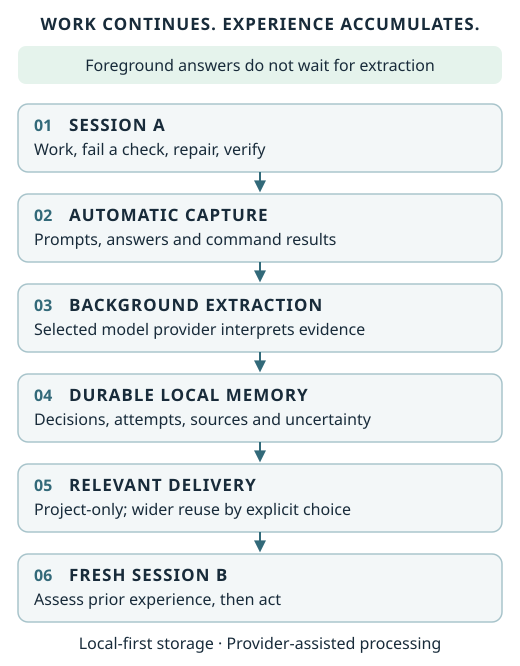
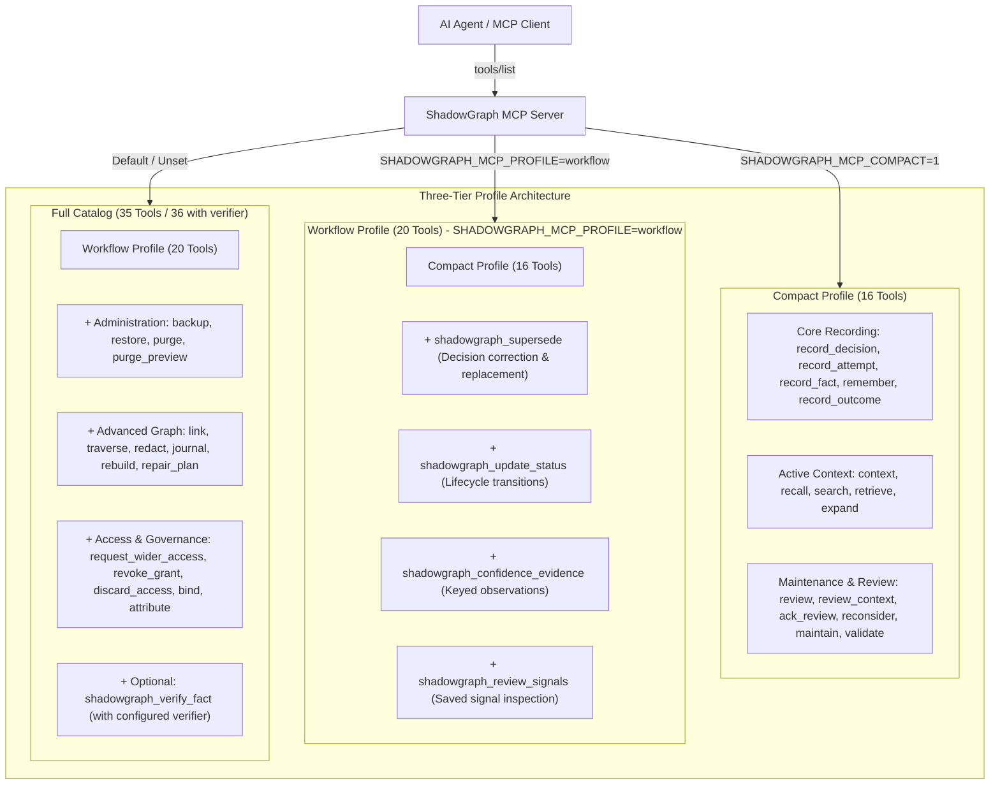
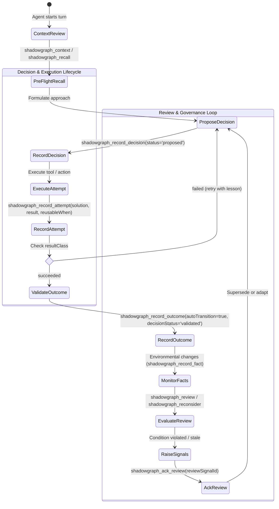
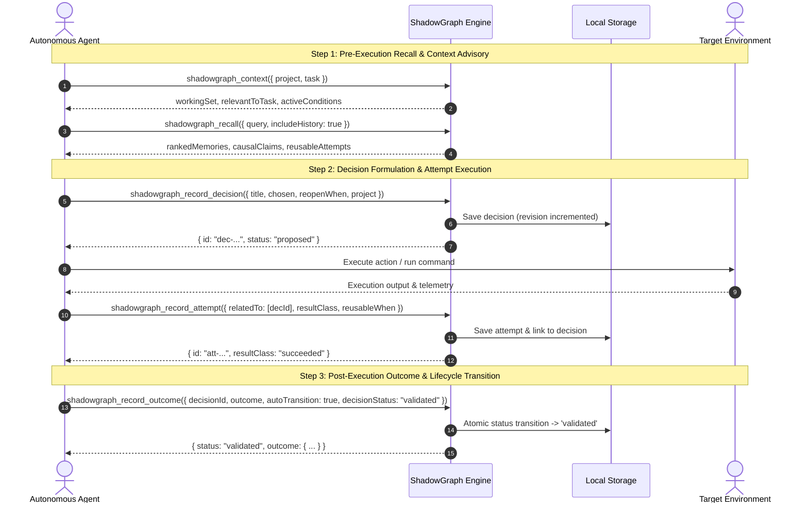

# ShadowGraph

**Carry useful development experience into the next agent session.**

ShadowGraph records what worked, what failed, and why a decision was made—then supplies relevant experience when you continue working. The demonstrated automatic paths are the **Windows Codex terminal wrapper** and, in print mode, **Claude Code CLI hooks on Windows**, after one-time setup in projects you enroll.

[](https://github.com/LiLara-AI/shadowgraph/actions/workflows/ci.yml)
[](https://github.com/LiLara-AI/shadowgraph/releases/tag/v0.44.2)

[Get started](#quick-start-windows-codex) · [Supported workflows](#supported-workflows) · [Release & downloads](https://github.com/LiLara-AI/shadowgraph/releases/tag/v0.44.2) · [Documentation](#documentation)



*After setup, work normally. Memory processes in the background; reuse follows your project and sharing choices. [Editable diagram](docs/assets/workflow.svg).*

## From a failed check to useful experience

In a bounded Windows demonstration, an agent ran a parser check that failed because empty fields were missing. It removed a filtering step and reran the unchanged check successfully. Its explanation included the rejected alternative: reconstructing empty fields later would lose their original positions and add complexity.

The wrapper captured the actual command results and explanation. A fresh session working on a differently delimited reader received the relevant experience automatically, identified it as prior-session evidence **before its first command**, and preserved empty fields in its implementation. Its check passed.

This demonstrates one working path, not perfect recall. Extraction can be delayed: two ordinary tasks completed while earlier memory was still pending, then processing recovered automatically. No memory reminder or manual extraction command was needed.

## Quick start: Windows Codex

### Prerequisites

- Windows x64, **PowerShell 7+**, and Node.js **22.5+** with npm (Node 24 recommended).
- Codex CLI **0.161.0**, signed in through your existing ChatGPT subscription. The adapter explicitly selects **`gpt-6.1-sol`**; other executor versions and API-key/provider overrides are not supported by this profile.
- A project you choose to enroll, and a private directory **outside source control** for memory and configuration.

The Codex executor is a separate prerequisite distributed as `@openai/codex`. ShadowGraph itself is **not published to npm**. Installing ShadowGraph alone does not enable automatic memory.

### 1. Install

Run in PowerShell 7+. The version is pinned; the [release](https://github.com/LiLara-AI/shadowgraph/releases/tag/v0.44.2) includes `SHA256SUMS.txt` for the tarball.

```powershell
npm install --global https://github.com/LiLara-AI/shadowgraph/releases/download/v0.44.2/shadowgraph-unified-plugin-0.44.2.tgz

$executorDir = Join-Path $env:LOCALAPPDATA 'ShadowGraph-Codex-0.161.0'
npm install --prefix $executorDir @openai/codex@0.161.0
$codexExe = (Get-ChildItem (Join-Path $executorDir 'node_modules/@openai') -Filter codex.exe -Recurse | Select-Object -First 1).FullName
& $codexExe --version
& $codexExe login status
```

If needed, use `& $codexExe login` and complete Codex's normal sign-in yourself. Select the native `codex.exe`, not an npm shim. Setup checks its version, binary identity and account route. Do not copy authentication files.

### 2. Enroll your project once

Run this **from the project directory you want to enroll**. Choose a descriptive project name; `demo` is an example.

```powershell
$memoryHome = Join-Path $env:LOCALAPPDATA 'ShadowGraph-Codex-Memory'
$setupFile = Join-Path $env:LOCALAPPDATA 'shadowgraph-codex-setup.json'
@{
  executable = $codexExe
  hostMode = 'workspace'
  projects = @(@{ project = 'demo'; cwd = (Get-Location).Path })
} | ConvertTo-Json -Depth 5 | Set-Content -Encoding utf8 $setupFile

shadowgraph-codex.cmd setup --config $setupFile --home $memoryHome
shadowgraph-codex.cmd status --home $memoryHome
```

Persistent setup asks for genuine owner consent at your terminal. Review the project, executor and provider scope before confirming. Workspace permissions and managed execution rules still apply. PowerShell 7 writes this JSON as UTF-8 without a byte-order mark.

### 3. Work normally

From the enrolled project, launch:

```powershell
$memoryHome = Join-Path $env:LOCALAPPDATA 'ShadowGraph-Codex-Memory'
shadowgraph-codex.cmd run --home $memoryHome
```

Enter ordinary task prompts, one line per turn. Launch the same command again for a fresh session. Relevant memory is supplied before each new turn; you do not need to say “remember” or “search memory.” Only work launched through this wrapper is observed.

Answers appear without waiting for extraction. Pending memory retries while the wrapper is open and on later launches. Closing it stops the bounded worker; **there is no permanent background daemon**. For configuration, pending-state troubleshooting and limits, see the [Codex guide](docs/codex-integration.md).

## What survives a session

| Experience | What stays attached |
| --- | --- |
| Decisions | Chosen approach, alternatives, reasons and conditions for reconsideration |
| Attempts and outcomes | What was tried and the observed result; inferred causes remain distinct |
| Evidence | Source quotations, captured command results and provenance |
| Current state | Corrections and supersession, while retaining history |
| Uncertainty | Model-proposed interpretation, missing conditions and limits of the evidence |

Stored records are inspectable. A model interpretation is not independently verified truth, and a useful lesson is not automatically valid in every project.

## Sharing and control

Memory starts **project-only**. You can explicitly share selected enrolled projects, select all currently permitted projects, exclude sources, revoke wider sharing, or pause the integration. Capture scope and read sharing are separate choices.

```powershell
# From an enrolled project; use the same private home as setup.
shadowgraph-codex.cmd share --home $memoryHome --mode selected --projects demo,shared-library
shadowgraph-codex.cmd share --home $memoryHome --mode all-permitted --exclude confidential-project
shadowgraph-codex.cmd share --home $memoryHome --mode project
shadowgraph-codex.cmd pause --home $memoryHome
shadowgraph-codex.cmd resume --home $memoryHome
```

Replace names with your enrolled projects. Sharing is explicit and revocable, not an automatic permission detector. Corrections retain history; source dependencies prevent copied memory-informed answers from bypassing later revocation. Already displayed information cannot be erased from a transcript or a person's knowledge. [Details and inspection commands](docs/codex-integration.md).

**Local-first, with a configured provider.** Canonical memory stays in your private local store. Automatic extraction and host delivery send selected captured/context data through the configured model provider and require its account and network. Pattern redaction cannot guarantee every secret is removed. There is no hosted sync or telemetry. [Data lifecycle, backup and deletion](docs/data-lifecycle.md).

## MCP interface profiles

Full remains the default (35 tools, or 36 with a configured verifier). Compact
remains 16 tools. The opt-in Workflow Profile offers 20 tools: Compact plus
stored review signals, keyed confidence evidence, decision status transitions and
explicit supersession, using the existing handlers and access controls.

### Architecture & Multi-Tier Profiles



| Server environment | Inventory | Scope & Target Audience |
| --- | ---: | --- |
| Profile unset; compact unset or `0` | Full: 35 / 36 | Complete administrative, access management, and deep graph engine |
| Profile unset; `SHADOWGRAPH_MCP_COMPACT=1` | Compact: 16 | Fast cognitive loop with low token overhead for standard tasks |
| `SHADOWGRAPH_MCP_PROFILE=workflow`; compact unset or `0` | Workflow: 20 | Complete decision-to-attempt lifecycle and review signal management |

### Autonomous Agent Memory & Decision Lifecycle



### Consequential Work Workflow



### Profile Inventory & Capability Comparison Matrix

| Capability Category | Compact (16 Tools) | Workflow (20 Tools) | Full (35/36 Tools) | Primary Tool(s) |
|---|:---:|:---:|:---:|---|
| **Architectural Decisions** | ✅ | ✅ | ✅ | `shadowgraph_record_decision` |
| **Attempt Recording & Reuse** | ✅ | ✅ | ✅ | `shadowgraph_record_attempt` |
| **Bi-temporal Fact Recording** | ✅ | ✅ | ✅ | `shadowgraph_record_fact` |
| **Outcome Recording & autoTransition**| ✅ | ✅ | ✅ | `shadowgraph_record_outcome` |
| **Episodic & Procedural Memory**| ✅ | ✅ | ✅ | `shadowgraph_remember` |
| **Ranked Recall & Semantic Search**| ✅ | ✅ | ✅ | `shadowgraph_recall` |
| **Exact Search & Arabic Stemming** | ✅ | ✅ | ✅ | `shadowgraph_search` |
| **Graph Retrieval & Expansion** | ✅ | ✅ | ✅ | `shadowgraph_retrieve`, `shadowgraph_expand` |
| **Task Context & Advisory** | ✅ | ✅ | ✅ | `shadowgraph_context` |
| **Review Execution & Persist** | ✅ | ✅ | ✅ | `shadowgraph_review`, `shadowgraph_review_context` |
| **Review Signal Acknowledgment**| ✅ | ✅ | ✅ | `shadowgraph_ack_review` |
| **Signal Reconsideration** | ✅ | ✅ | ✅ | `shadowgraph_reconsider` |
| **Graph Validation & Maintenance**| ✅ | ✅ | ✅ | `shadowgraph_validate`, `shadowgraph_maintain` |
| **Decision Supersession** | ❌ | ✅ | ✅ | `shadowgraph_supersede` |
| **Decision Status Lifecycle** | ❌ | ✅ | ✅ | `shadowgraph_update_status` |
| **Keyed Confidence Evidence** | ❌ | ✅ | ✅ | `shadowgraph_confidence_evidence` |
| **Stored Review Signal Inspection**| ❌ | ✅ | ✅ | `shadowgraph_review_signals` |
| **Graph Traversal & Linking** | ❌ | ❌ | ✅ | `shadowgraph_link`, `shadowgraph_traverse` |
| **Content Redaction** | ❌ | ❌ | ✅ | `shadowgraph_redact` |
| **Backup & Restoration** | ❌ | ❌ | ✅ | `shadowgraph_backup`, `shadowgraph_restore` |
| **Store Purge & Quarantine** | ❌ | ❌ | ✅ | `shadowgraph_purge`, `shadowgraph_purge_preview` |
| **Journal & Index Rebuilding** | ❌ | ❌ | ✅ | `shadowgraph_journal`, `shadowgraph_rebuild`, `shadowgraph_repair_plan` |
| **Access Governance & Delegation**| ❌ | ❌ | ✅ | `shadowgraph_request_wider_access`, `shadowgraph_bind`, `attribute` |
| **External Fact Verification** | ❌ | ❌ | Optional (36th) | `shadowgraph_verify_fact` |

### MCP Tool Selection & Disambiguation Guide

| When you need to... | Use this tool | Do NOT use | Why? |
|---|---|---|---|
| Retrieve ranked facts, procedural lessons, and temporal history for a prompt | `shadowgraph_recall` | `shadowgraph_search` | `recall` computes relevance scoring, temporal validity, and returns structured history chains; `search` is strict term-matching. |
| Find records containing specific keywords or Arabic stems across tasks/tags | `shadowgraph_search` | `shadowgraph_retrieve` | `search` supports partial match fallback (`matchMode: 'partial'`) and Arabic root normalization. |
| Find a focal record and walk its immediate neighbors | `shadowgraph_retrieve` | `shadowgraph_traverse` | `retrieve` is available in Compact/Workflow; `traverse` requires Full mode and does multi-hop graph traversal (depth 1–10). |
| Fetch immediate project working set and active conditions without writes | `shadowgraph_context` | `shadowgraph_review_context` | `context` is a read-only fast path saving nothing; `review_context` evaluates and commits review signals. |
| Inspect pending review signals without triggering reevaluation | `shadowgraph_review_signals` | `shadowgraph_review` | `review_signals` inspects already stored signals (Workflow/Full); `review` runs live condition evaluations against all recorded facts. |
| Replace an obsolete decision with an updated architectural choice | `shadowgraph_supersede` | `shadowgraph_record_outcome` | `supersede` preserves both decisions with an explicit superseded link; `record_outcome` validates or closes an existing decision without replacing it. |
| Close out a decision after completing execution | `shadowgraph_record_outcome` | `shadowgraph_update_status` | `record_outcome` with `autoTransition: true` records lessons and advances lifecycle in one atomic call. |

Set the environment on the MCP server process, then restart/reconnect and refresh
`tools/list`. There is no agent-callable mode switch. Workflow does not expose
administrative repair or destructive cleanup. See the [configuration and workflow
guide](docs/mcp-compatibility.md#optional-workflow-profile-complete-the-decision-loop).

Use `shadowgraph_search` for literal every-term matching, `shadowgraph_recall`
for ranked experience, `shadowgraph_retrieve` for matches plus ordered graph
neighbours, `shadowgraph_context` for a working set without saving signals, and
`shadowgraph_expand` for a returned context-line handle. In Workflow or Full,
`shadowgraph_review_signals` reads saved review signals; `shadowgraph_review`,
`shadowgraph_review_context` and `shadowgraph_reconsider` evaluate reopen rules
and persist signals. Access-key reads save a bounded audit. See the [read and
review guide](docs/mcp-compatibility.md#choosing-a-read-or-review-operation).

## Supported workflows

| Workflow | What this preview establishes |
| --- | --- |
| Windows `shadowgraph-codex run` | Installed command-executing workflow; automatic capture, background extraction, fresh-session delivery and recovery after delay/failure |
| MCP, CLI, HTTP and JavaScript API | Explicit record/read operations; MCP exposes 16 compact or 35 full tools. Tool calls alone do not observe all work |
| Claude Code CLI hooks (Windows) | After one-time setup on Claude Code CLI 2.x (verified on 2.1.302 and 2.1.312, print mode): durable capture under contention, automatic extraction by an owner-selected model, delivery to fresh sessions, corrections of decisions (a decision kept verbatim is linked and marked as corrected, not closed) and revocable sharing. On Windows, use Claude Code 2.1.312 or later: up to 2.1.302, `claude -p` exits only after the extraction worker it started finishes (up to 4 minutes; the result is printed first). See the [Claude Code guide](docs/claude-code-integration.md#support-and-evidence) for what was verified and its limits. Claude Desktop, the interactive TUI, resume, macOS and Linux are not verified |
| Codex Desktop UI or ordinary CLI launched elsewhere | Not observed by this wrapper |
| Glama MCP container | Credential-free MCP surface; cannot capture a user's Windows Codex sessions by itself |

The accepted Glama release read back on 2026-11-03 has display label **0.42.6** and runtime **0.43.2**, with
the 20-tool Workflow profile. See the [release/runtime identity mapping](docs/mcp-compatibility.md#accepted-0432-release-mapping-read-back-2026-11-03). A new package release alone does not update that container.

### Store locking and retry limits (0.43.1)

Store fences require a local filesystem with exclusive hard-link creation (tested
on Linux and Windows CI). Network/shared filesystems, cross-host stores, mixed
Windows/WSL writers and concurrent old/new runtime writers are not supported.
Stop every writer and back up private state before upgrading; schema 7 is unchanged.

A live PID keeps its lock even if its timestamp is old. Stale store locks with a
dead owner are reclaimed serially. A `.lock.reclaim` guard is never stolen merely
because it is old: a suspended owner is indistinguishable from a crashed one.
If a crashed reclaimer leaves this guard while a stale store lock still needs
reclamation, writes time out with
`storage_lock_timeout`. Stop every process using that store (including hooks and
workers), preserve a private backup, positively identify the exact orphan guard,
then remove only that guard and retry. Follow the
[stopped-writer recovery checklist](docs/migration.md#recovering-an-orphan-reclaim-guard).
Do not remove a live writer's lock or infer an orphan from age alone.
Lock-candidate `.lock.*.candidate` files contain ownership tokens, not store content;
a process killed before linking can leave one. Remove such orphans only with all
writers stopped.

Capture retries track an entry's stable payload key throughout one hook, including
when another hook has renamed the file. A non-contention failure consumes at most
one attempt per hook; after eight failed hook cycles the entry is dropped with a
content-free marker. Store contention, deadline exhaustion and newer schemas leave
input pending without consuming an attempt. Pending input survives hook restarts;
the existing seven-day age and spool-size bounds still apply. This patch adds no
new live model or automatic-memory support claims.

### Preview limits

Each host turn has a 120-second process limit. Background extraction has bounded calls, retries and concurrency; a backlog can remain honestly pending. Native command events and user/assistant text are captured, but not every native tool-event type. Retrieval happens between turns, not inside a running turn.

For Claude Code CLI, delivered experience is not always applied: in one live run a fresh session received an earlier lesson and did not apply it. After extraction is deactivated and activated again, items left pending under the earlier setup are not extracted; status reports them as `priorSetup`. The Claude Code evidence is one Windows print-mode (`claude -p`) path, not every host.

This is **Release v0.44.2**, not stable/GA. There are no claims of perfect semantic classification, universal language support, cost or time savings, superiority over native memory, or a human third-party security audit. See [release notes](RELEASE_NOTES.md), [security scope](SECURITY.md) and [benchmark status](docs/benchmark-report.md).

## Upgrade and storage

0.43.2 tightens automatic correction evidence and transient file-error recovery, and reports capture gaps and loss-count saturation. Review acknowledgement keeps its accurate Destructive hint; a journal does not make replacement of current state additive. [Patch details and recovery](docs/migration.md#moving-to-0432).

Stop active work and back up your stores and private integration home before upgrading. v0.43.2 retains schema 7; changed source/executor/account identity requires setup again. Older pending work with different setup provenance is held, not silently reassigned. [Upgrade and rollback guide](docs/migration.md).

### Moving between 0.41.0 and 0.42.0

The historical schema-5/schema-7 migration and downgrade instructions remain in the [migration guide](docs/migration.md#moving-between-0410-and-0420). Preserve a backup made before upgrading.

## Documentation

| Need | Guide |
| --- | --- |
| Automatic Windows setup, sharing, limits and troubleshooting | [Codex integration](docs/codex-integration.md) |
| Manual installation, MCP configuration, CLI/HTTP/JavaScript and storage | [Manual usage](docs/manual-usage.md) |
| Other clients and existing hooks | [Integrations](integrations/README.md) · [Claude extraction](docs/extraction.md) |
| API and protocol details | [API reference](docs/api-reference.md) · [MCP compatibility](docs/mcp-compatibility.md) |
| A decision that reopens when conditions change | [Decision-memory demo](docs/decision-memory-demo.md) |
| Privacy, backups and recovery | [Data lifecycle](docs/data-lifecycle.md) · [Migration](docs/migration.md) |
| Development and feedback | [Contributing](CONTRIBUTING.md) · [Issues](https://github.com/LiLara-AI/shadowgraph/issues) · [Discussions](https://github.com/LiLara-AI/shadowgraph/discussions) |

Please redact private paths, prompts, stores and credentials before reporting an issue. Report security vulnerabilities [privately](https://github.com/LiLara-AI/shadowgraph/security/advisories/new).

[MIT license](LICENSE). No npm publication, paid hosting or standing extraction is implied by installing this release.
