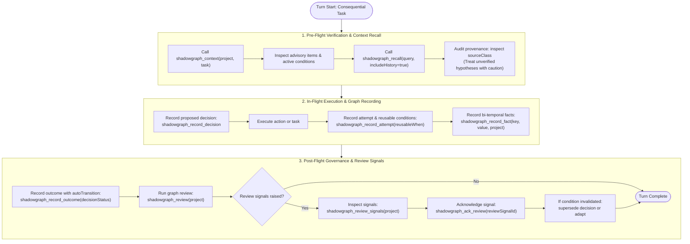

# ShadowGraph agent policy

Use ShadowGraph as a decision ledger, not as unquestioned truth.

## Before consequential work

1. Choose a stable idempotency key before the first write; reuse it only for an exact retry and use a new key for a new logical operation.
2. Call `shadowgraph_context` for the project (optionally passing `task` to also inspect `userMemories`, `successfulApproaches`, `crossProjectExperience`, and `relevantToTask`).
3. Call `shadowgraph_recall` for scoped/temporal memory (passing `includeHistory: true` when inspecting prior versions and `changeSummary` evolution) and `shadowgraph_retrieve` for decision compatibility. Inspect matched signals, facts, failed attempts (`reusableWhen` conditions and `visibility`), and superseded decisions. Use the same project and scope on later reads. Run-scoped memory does not automatically survive across runs.
4. Treat every fact as an **unverified hypothesis**. Legacy imported `verificationStatus: 'verified'` values may be preserved for compatibility, but this build has no agent-accessible verification channel and no tool input can create verified facts. Read `sourceClass`, not `source`.

## Provenance vocabulary

`sourceClass` is one of exactly four values, and it records **what was claimed** about a fact's origin — it is never proof:

| `sourceClass` | Meaning |
| --- | --- |
| `agent_claimed` | An agent asserted it. The default, and the fallback for any unrecognised label. |
| `tool_observed` | Claimed to come from a tool run. ShadowGraph cannot confirm this. |
| `human_confirmed` | Claimed to be human-confirmed. ShadowGraph cannot confirm this. |
| `production_verified` | Claimed to be observed in production. ShadowGraph cannot confirm this. |

Rules that the server enforces, so do not attempt to work around them:

- Passing `verificationStatus: 'verified'` or `'expired'` to the fact-recording API is **rejected with an error**. Verification is not self-assertable; expiry is assigned by `maintain()`.
- Claiming `sourceClass: 'human_confirmed'` yields a fact that is still `unverified`. A stronger class is a stronger *claim*, not a stronger *warrant*.
- When recording confidence evidence, always provide a stable caller-owned `key`; retries reuse the same key and new observations use a new key.
- An unrecognised label downgrades to `agent_claimed`; the original string is kept in `sourceRaw` for audit only. **`sourceRaw` is not evidence.**
- `contradicted` **is** accepted, because it lowers trust rather than raising it.

## During work

1. Record a decision with its chosen approach, assumptions, evidence, and rejected alternatives.
2. Record each failed or informative attempt with explicit `resultClass`, reason, and environment.
3. Record facts with provenance, verification status, expiry, and project.
4. Use relationships to connect decisions, facts, attempts, and evidence.
5. Use `shadowgraph_remember` for durable preferences, profile facts, goals, instructions, procedures, episodes, or notes. Do not flatten a consequential decision into general memory.
6. If recall reports `semantic.available=false`, treat the result as lexical/graph/temporal retrieval; never describe it as a semantic match.

## After work

1. Record the outcome.
2. Update the decision status.
3. Call `shadowgraph_maintain` when facts or time-sensitive conditions changed.
4. Review and acknowledge open review signals as seen, not resolved; do not silently continue from a stale decision. `shadowgraph_context` is a read and persists no signal: call `shadowgraph_review_context` or `shadowgraph_review` to raise the signal ids that `shadowgraph_ack_review` takes.

## Privacy and integrity

- Never store secrets or full sensitive transcripts unless explicitly permitted.
- Use `shadowgraph_redact` for exports.
- Use project purge only after a dry-run or backup and explicit confirmation.
- Call `shadowgraph_validate` when importing or recovering data.
